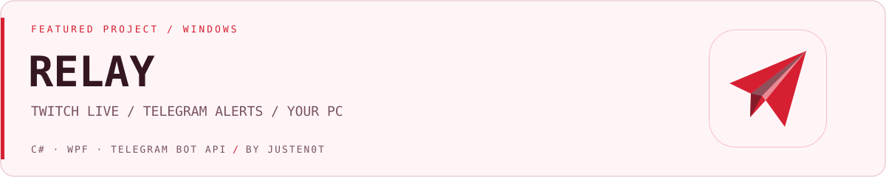
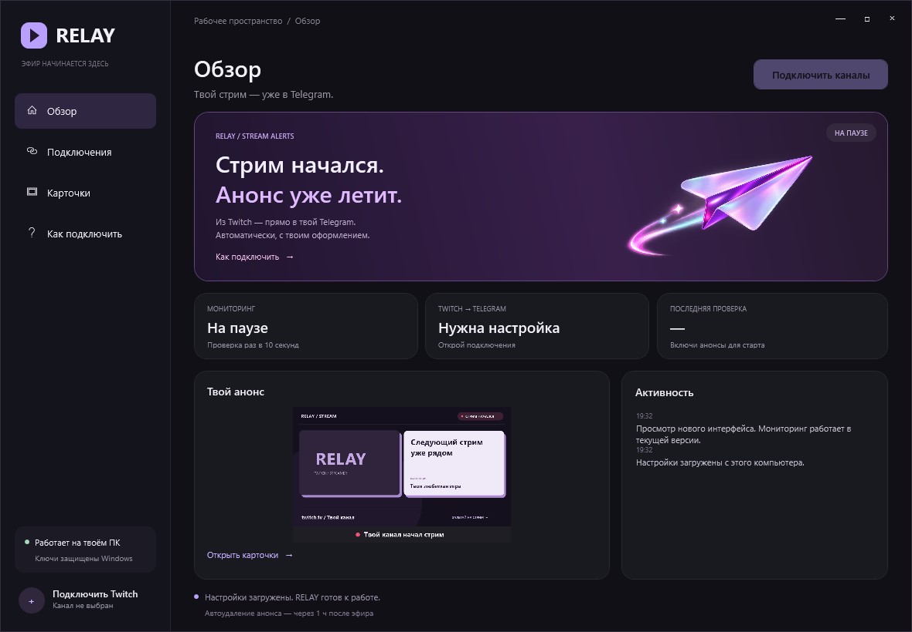

<picture>
  <source media="(prefers-color-scheme: dark)" srcset="assets/cover-dark.svg">
  
</picture>

# RELAY

Твой стрим — уже в Telegram. Приложение для Windows само публикует анонс Twitch, обновляет карточку во время эфира и подводит итог в том же сообщении.

**Версия 2.3.1** · Windows 10/11 x64 · Автор — [JustEn0t](https://github.com/JustEn0t)

**[Скачать установщик EXE](https://github.com/JustEn0t/Relay/releases/latest/download/RELAY-Setup-2.3.1.exe)** · [Все загрузки и SHA-256](https://github.com/JustEn0t/Relay/releases/latest) · [Как подключить](docs/setup.md)

Установка для текущего пользователя, без запроса прав администратора. Ярлык в меню «Пуск», необязательный ярлык на рабочем столе и удаление через настройки Windows. Есть переносимая ZIP-версия.

## Возможности

- **Один эфир — один пост.** Начало, текущий эфир и завершение обновляют одно сообщение.
- **Карточка эфира.** Название, категория, обложка игры или публичный кадр Twitch и кнопка перехода на канал.
- **Статусы по ходу стрима.** Первую минуту — «начал стрим», затем — «ведёт трансляцию», после подтверждённого конца — итог.
- **Текущий онлайн.** Число зрителей показывается во время эфира. Среднего и пикового онлайна в итогах нет.
- **История изменений.** Смена названия и категории с временем по МСК.
- **Автоудаление.** Через час после подтверждённого конца анонс удаляется. Очередь сохраняется между запусками.
- **Свой стиль.** Тёмный интерфейс, лавандовые акценты, предпросмотр трёх состояний карточки и встроенная инструкция.
- **На твоём ПК.** Не нужен отдельный сервер или платный хостинг.



## Быстрый старт

1. Скачай **RELAY-Setup-2.3.1.exe** из [Releases](https://github.com/JustEn0t/Relay/releases/latest) и установи приложение.
2. Создай своего Telegram-бота через официального [@BotFather](https://t.me/BotFather). Добавь его администратором своего канала с правом публикации.
3. Зарегистрируй своё приложение в [Twitch Developer Console](https://dev.twitch.tv/console/apps). Нужны Client ID и Client Secret.
4. В RELAY открой «Подключения», введи свои данные и нажми «Сохранить и проверить».
5. Включи анонсы в «Обзоре». Держи RELAY открытым во время стрима и ещё час после него.

[Пошаговая настройка, ограничения и обновление →](docs/setup.md)

RELAY проверяет Twitch каждые 10 секунд; сбои сети и лимиты сервисов могут увеличить задержку. Завершение подтверждается тремя последовательными проверками без эфира. Twitch может обновлять свои данные с задержкой. Если приложение закрыто, оно не мониторит канал и не удаляет сообщения; сохранённая очередь обрабатывается при следующем запуске. Telegram ограничивает удаление 48 часами с момента отправки сообщения.

## Данные и безопасность

Каждый пользователь подключает **своего** бота и своё приложение Twitch. В публичной сборке нет готового аккаунта, токенов или настроек автора.

- Настройки и очередь удаления защищены **Windows DPAPI** для текущего пользователя Windows.
- Запросы идут напрямую по HTTPS к Twitch, Telegram и CDN Twitch. Перенаправления отключены; адреса API и загрузки картинок ограничены в коде.
- Нет сервера разработчика, аналитики, рекламы, автообновления или телеметрии.
- Пароль Twitch, ключ трансляции OBS и доступ к файлам игр не нужны.
- Карточки и их подписи публикуются в выбранный тобой Telegram-канал. Публичный кадр стрима кэшируется локально.

DPAPI защищает данные на диске, но не от программ, работающих под той же учётной записью Windows, администратора или уже заражённого ПК. Во время работы ключи присутствуют в памяти приложения. Это не обещание отсутствия любых уязвимостей.

[Политика данных](PRIVACY.md) · [Безопасность и сообщение об уязвимости](SECURITY.md) · [Что проверено в релизе](docs/release-checks.md)

Сборка не подписана платным сертификатом издателя: Windows может показать предупреждение о неизвестном издателе. Проверить целостность можно по `SHA256SUMS.txt` из релиза. Контрольная сумма подтверждает совпадение файла, а не отсутствие всех возможных уязвимостей.

## Сборка из исходников

Нужны Windows x64, PowerShell, .NET Framework 4.8 и его штатный компилятор. Для установщика — [Inno Setup 6](https://jrsoftware.org/isinfo.php).

```powershell
powershell -NoProfile -File scripts/build.ps1
powershell -NoProfile -File scripts/test.ps1
powershell -NoProfile -File scripts/check-release.ps1
powershell -NoProfile -File scripts/release.ps1 -InnoCompiler "C:\Program Files (x86)\Inno Setup 6\ISCC.exe"
```

Результат в `dist/`: установщик EXE, переносимая версия ZIP и SHA-256. В установщик попадают только собранный EXE, инструкция и лицензия. Настройки и локальные превью не упаковываются.

Технологии: **C# · WPF · .NET Framework · Twitch Helix API · Telegram Bot API · Inno Setup**.

## О проекте

Разрабатываю RELAY, чтобы анонсы стримов работали на собственном ПК и не требовали передачи токенов стороннему сервису уведомлений.

Автор — **[Арсений / JustEn0t](https://github.com/JustEn0t)**. Код и собственные ресурсы — [MIT](LICENSE). Иллюстрация в интерфейсе создана с помощью генератора изображений; подробности в [описании ресурсов](docs/assets.md).

Независимый проект, не связан с Twitch, Telegram или Streamozavr. Названия, логотипы и загружаемые материалы сервисов и игр принадлежат соответствующим владельцам. RELAY использует официальные API и не предоставляет права на чужой контент.
